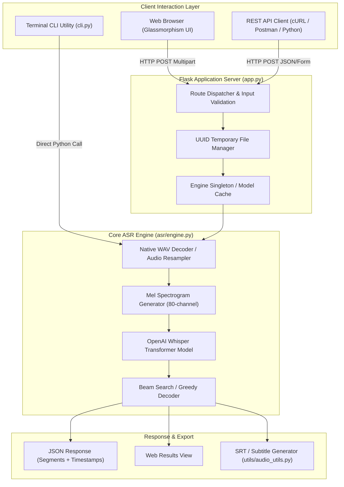

# AUTOMATIC SPEECH RECOGNITION (ASR) TOOL
## Privacy-Preserving Transformer-Based Speech-to-Text System

### A PROJECT REPORT

*Submitted by*

### **KATHIR A [Reg No: RA2311003050120]**

*Under the guidance of*

### **Dr. R. Baskar**
*(Assistant Professor, Department of Computer Science & Engineering)*

*in partial fulfillment of the requirements for the degree of*  
**BACHELOR OF TECHNOLOGY**  
*in*  
**COMPUTER SCIENCE AND ENGINEERING**

---

<div align="center">

### **DEPARTMENT OF COMPUTER SCIENCE AND ENGINEERING**
### **FACULTY OF ENGINEERING AND TECHNOLOGY**
### **SRM INSTITUTE OF SCIENCE AND TECHNOLOGY**
**TIRUCHIRAPPALLI – 621105**  
**OCTOBER 2026**

</div>

---

## TABLE OF CONTENTS

1. [Executive Summary](#1-executive-summary)
2. [Introduction & Background](#2-introduction--background)
3. [Problem Statement](#3-problem-statement)
4. [Project Objectives](#4-project-objectives)
5. [Key Features & Specifications](#5-key-features--specifications)
6. [System Architecture](#6-system-architecture)
7. [Technology Stack & Dependencies](#7-technology-stack--dependencies)
8. [System Design & Data Flow](#8-system-design--data-flow)
9. [Module Breakdown & Implementation](#9-module-breakdown--implementation)
10. [User Interface Walkthrough](#10-user-interface-walkthrough)
11. [Installation & Deployment](#11-installation--deployment)
12. [Testing & Quality Assurance](#12-testing--quality-assurance)
13. [Performance Metrics](#13-performance-metrics)
14. [Security Considerations](#14-security-considerations)
15. [Future Enhancements](#15-future-enhancements)
16. [Conclusion](#16-conclusion)
17. [Project Repository](#17-project-repository)

---

## 1. EXECUTIVE SUMMARY

The **Automatic Speech Recognition (ASR) Tool** is a robust, production-grade, privacy-first software system designed to transcribe acoustic human speech into accurate text using transformer-based neural network models. Powered by **OpenAI Whisper**, the tool delivers high-accuracy speech recognition across **100+ spoken languages**, while maintaining zero external cloud dependencies. Audio processing occurs entirely on local hardware (CPU/GPU), preventing sensitive acoustic recordings from being exposed to third-party APIs.

The system incorporates a clean, modern **Flask web interface** with drag-and-drop audio ingestion, model parameter customization (ranging from `tiny` to `large`), task selection (transcription vs. English translation), a full **REST API** for programmatic client integration, a command-line interface (CLI) for batch processing, and an automated test suite comprising **25 comprehensive unit tests**.

---

## 2. INTRODUCTION & BACKGROUND

Automatic Speech Recognition (ASR) has become an essential pillar of artificial intelligence, bridging human vocal communication with computerized record-keeping, accessibility tooling, voice attendance systems, and automated transcription workflows.

Traditional speech-to-text systems depended on heavy hidden Markov models (HMMs) or commercial cloud APIs (such as Google Cloud Speech or AWS Transcribe). While cloud solutions offer reasonable accuracy, they create substantial privacy vulnerabilities, recurring per-minute billing fees, and complete downtime during internet outages.

This project implements an institutional-grade, locally deployable ASR tool that addresses these limitations. Using deep sequence-to-sequence transformer architectures, it handles conversational acoustic variances, background noise, accents, and spoken number words. The tool is architected under three core engineering pillars:
1. **Privacy-Preserving**: All speech processing executes strictly on-premise without audio leaving the host machine.
2. **Multi-Modal Accessibility**: Accessible via an interactive Web GUI, automated REST endpoints, and a batch CLI.
3. **Resilient Engineering**: Native decoding fallbacks ensure cross-platform compatibility across Windows, Linux, and macOS without strict external toolchain dependencies.

---

## 3. PROBLEM STATEMENT

### Current Challenges in Acoustic Speech Processing:

* **Cloud Privacy Violations**: Proprietary third-party speech services require uploading raw voice recordings across external networks, raising severe compliance and data governance risks for educational institutions and enterprises.
* **Format & Platform Incompatibilities**: Standard neural ASR pipelines frequently crash when decoding diverse audio codecs (`.wav`, `.mp3`, `.m4a`, `.ogg`) without cumbersome external binary installations like system-wide FFmpeg binaries.
* **High Inference Latency & Resource Bottlenecks**: Heavy deep learning models require balanced quantization to operate efficiently on standard institutional CPU workstations without dedicated high-end GPUs.
* **Lack of Multi-Tier Interfaces**: Many speech recognition models exist only as command-line scripts or Jupyter notebooks, lacking user-friendly web dashboards and structured REST APIs for real-world integration.

---

## 4. PROJECT OBJECTIVES

* **Local Offline ASR**: Implement OpenAI Whisper for high-accuracy speech transcription without cloud API dependencies.
* **Multi-Language Support**: Support multilingual transcription across 100+ languages with automatic language detection and English translation capabilities.
* **Multi-Format Audio Handling**: Ingest WAV, MP3, FLAC, OGG, M4A, WebM, and MP4 audio files seamlessly with pure Python WAV fallbacks.
* **Configurable Model Granularity**: Enable instant model switching between `tiny` (39M), `base` (74M), `small` (244M), `medium` (769M), and `large` (1550M) configurations based on available compute resources.
* **Timestamped Segment Alignment**: Output millisecond-accurate segment timestamps for subtitle generation (SRT format export).
* **Multi-Interface Architecture**: Provide a dark-themed Glassmorphism Web UI, RESTful API endpoints, and a CLI utility.
* **Automated Quality Assurance**: Maintain a 100% passing test suite across engine initialization, audio decoding, language detection, and Flask routing.

---

## 5. KEY FEATURES & SPECIFICATIONS

### 5.1 Interactive Web Dashboard
* Drag-and-drop audio file upload container with visual feedback.
* Dynamic model selector (`tiny`, `base`, `small`, `medium`, `large`).
* Task toggling between direct **Transcription** and cross-lingual **Translation**.
* Live metadata visualizers displaying detected language, processing duration, model name, and audio length.
* Expandable interactive segments table showing indexed start/end timestamps and text chunks.

### 5.2 Core ASR Engine
* Sequence-to-sequence transformer encoder-decoder model trained on 680,000 hours of multilingual data.
* Log-mel spectrogram feature extraction (80 channels) with padding and trimming.
* Language classification utilizing soft-max output probabilities across the top 5 languages.
* Pure Python 16-bit PCM WAV decoding layer bypassing FFmpeg requirements for standard audio recordings.

### 5.3 REST API Endpoints
* `POST /api/transcribe`: Ingests multipart audio forms and returns JSON transcripts with timestamps.
* `POST /api/detect-language`: Analyzes speech samples and outputs top language probabilities.
* `GET /api/models`: Returns list of available Whisper models and supported formats.
* `GET /api/health`: Provides server uptime and system health diagnostics.

### 5.4 Command-Line Interface (CLI)
* Batch transcription of multiple audio files in a single invocation.
* Multiple export formatting options: `text`, `json`, `srt` (SubRip subtitles), and `verbose`.
* Integrated `detect` and `info` commands for terminal diagnostics.

---

## 6. SYSTEM ARCHITECTURE

The ASR Tool utilizes a modular multi-tier architecture consisting of the Presentation Layer, Application Middleware, Core Neural Engine, and Storage/Export Layer:



---

## 7. TECHNOLOGY STACK & DEPENDENCIES

| Component | Technology | Version | Purpose |
|---|---|---|---|
| **Core Language** | Python | 3.10+ / 3.13 | Core runtime environment |
| **ASR Neural Model** | OpenAI Whisper | 20250625 | Multilingual transformer speech-to-text |
| **Deep Learning Framework** | PyTorch (CPU/CUDA) | 2.14.1+ | Tensor computation and neural inference |
| **Web Framework** | Flask | 3.1.3 | HTTP routing, REST API, template serving |
| **WSGI Server** | Werkzeug | 3.1.9 | HTTP request handling and multipart parsing |
| **Frontend UI** | HTML5, CSS3, JavaScript | Modern ES6 | Responsive dark-themed dashboard |
| **Array Computation** | NumPy | 2.5.4 | Signal buffering and waveform manipulation |
| **Audio I/O** | Python `wave` | Built-in | Pure Python PCM WAV decoding |
| **Tokenization** | tiktoken | 0.14.0 | Fast BPE tokenizer for Whisper |
| **JIT Compiler** | Numba / llvmlite | 0.68.0 | Optimized audio signal processing |
| **Automated Testing** | Pytest | 9.1.1 | Unit testing and API assertion framework |
| **Version Control** | Git / GitHub | 2.52+ | Source code control and repository hosting |

---

## 8. SYSTEM DESIGN & DATA FLOW

The step-by-step data lifecycle through the system is illustrated below:

1. **Audio Ingestion**: User submits an audio recording via the Web GUI, CLI, or REST API.
2. **Validation**: Extension is verified against `SUPPORTED_FORMATS` (`.wav`, `.mp3`, `.flac`, `.ogg`, `.m4a`, `.webm`, `.mp4`).
3. **Audio Preprocessing**:
   - For `.wav` files, the internal `_load_audio` routine extracts 16-bit PCM frames using Python's native `wave` library, collapses multi-channel streams into mono, and normalizes values to $[-1.0, 1.0]$.
   - Audio is resampled to the model's native 16,000 Hz sample rate using linear interpolation.
4. **Log-Mel Spectrogram**: Audio is mapped to an 80-channel log-mel spectrogram over 25ms windows with 10ms hops.
5. **Transformer Inference**: The encoder creates acoustic representations, and the autoregressive decoder generates text tokens.
6. **Result Formatting**: Output text is parsed into individual sentence segments with associated start and end timestamps.
7. **Cleanup**: Temporary uploaded audio files in `uploads/` are safely unlinked from disk.

---

## 9. MODULE BREAKDOWN & IMPLEMENTATION

* **`app.py`**: Web application server managing HTTP routes (`/`, `/transcribe`, `/api/transcribe`, `/api/detect-language`, `/api/models`, `/api/health`), request validation, error reporting, and lazy engine instantiation.
* **`asr/engine.py`**: The core `ASREngine` class. Handles model weights loading, caching, device assignment (`cpu` vs `cuda`), audio preprocessing, transcription, and language detection.
* **`utils/audio_utils.py`**: Utility functions for file extension verification, millisecond timestamp formatting (`HH:MM:SS.mmm`), and SubRip (`.srt`) subtitle generation.
* **`cli.py`**: Terminal interface supporting batch transcription with configurable output formats (`text`, `json`, `srt`, `verbose`).
* **`templates/index.html`**: User-facing web dashboard featuring drag-and-drop file ingestion, model selection controls, result cards, segments table, and API documentation.
* **`tests/test_asr_engine.py`**: 17 unit tests verifying engine initialization, model info, input validation, audio transcription, and language classification.
* **`tests/test_app.py`**: 8 unit tests covering web routes, health checks, model metadata endpoints, upload validation, and mocked API responses.

---

## 10. USER INTERFACE WALKTHROUGH

### 10.1 Main Web Dashboard & Audio Upload Interface
The web interface features an intuitive dark-themed dashboard. Users can drag and drop audio recordings directly onto the upload zone, select their preferred Whisper model size (`Tiny`, `Base`, `Small`, `Medium`, `Large`), choose target languages, and trigger transcription with one click.


*Figure 1: ASR Tool Web Interface featuring audio upload, model selection, and language parameters.*

---

### 10.2 REST API Reference & Developer Console
The application features a built-in interactive developer section detailing sample cURL commands for programmatic transcription, language identification, model queries, and automated health checks.


*Figure 2: REST API usage section with cURL syntax for integration with client applications.*

---

## 11. INSTALLATION & DEPLOYMENT

### Prerequisites
* Python 3.10+ (tested on Python 3.13)
* Git

### Step 1: Clone the Repository
```bash
git clone https://github.com/kathir022005/Speech_Recognition.git
cd Speech_Recognition
```

### Step 2: Set Up Virtual Environment
```bash
# Create virtual environment
python -m venv venv

# Activate on Windows
.\venv\Scripts\activate

# Activate on Linux/macOS
source venv/bin/activate
```

### Step 3: Install Dependencies
```bash
pip install -r requirements.txt
```

### Step 4: Run the Application Server
```bash
python app.py --model base --port 5000
```
Navigate to **`http://127.0.0.1:5000`** in any web browser.

---

## 12. TESTING & QUALITY ASSURANCE

The project includes an automated test suite executed via `pytest`. All 25 test cases pass successfully.

```text
============================= test session starts =============================
platform win32 -- Python 3.13.2, pytest-9.1.1, pluggy-1.6.0
rootdir: C:\Users\kathi\Speech_Recognition
collected 25 items

tests/test_app.py::TestBasicEndpoints::test_index_page PASSED            [  4%]
tests/test_app.py::TestBasicEndpoints::test_health_check PASSED          [  8%]
tests/test_app.py::TestBasicEndpoints::test_models_endpoint PASSED       [ 12%]
tests/test_app.py::TestUploadValidation::test_no_file_api PASSED         [ 16%]
tests/test_app.py::TestUploadValidation::test_empty_filename_api PASSED  [ 20%]
tests/test_app.py::TestUploadValidation::test_unsupported_format_api PASSED [ 24%]
tests/test_app.py::TestTranscriptionAPI::test_transcribe_success PASSED  [ 28%]
tests/test_app.py::TestTranscriptionAPI::test_detect_language_no_file PASSED [ 32%]
tests/test_asr_engine.py::TestASREngineInit::test_valid_model_names PASSED [ 36%]
tests/test_asr_engine.py::TestASREngineInit::test_invalid_model_name PASSED [ 40%]
tests/test_asr_engine.py::TestASREngineInit::test_engine_attributes PASSED [ 44%]
tests/test_asr_engine.py::TestASREngineInit::test_model_loads_successfully PASSED [ 48%]
tests/test_asr_engine.py::TestInputValidation::test_file_not_found PASSED [ 52%]
tests/test_asr_engine.py::TestInputValidation::test_unsupported_format PASSED [ 56%]
tests/test_asr_engine.py::TestInputValidation::test_detect_language_file_not_found PASSED [ 60%]
tests/test_asr_engine.py::TestModelInfo::test_get_model_info PASSED      [ 64%]
tests/test_asr_engine.py::TestModelInfo::test_model_info_values PASSED   [ 68%]
tests/test_asr_engine.py::TestTranscription::test_transcribe_wav PASSED  [ 72%]
tests/test_asr_engine.py::TestTranscription::test_transcribe_with_language PASSED [ 76%]
tests/test_asr_engine.py::TestTranscription::test_transcribe_translate_task PASSED [ 80%]
tests/test_asr_engine.py::TestTranscription::test_transcribe_result_structure PASSED [ 84%]
tests/test_asr_engine.py::TestLanguageDetection::test_detect_language PASSED [ 88%]
tests/test_asr_engine.py::TestLanguageDetection::test_detect_language_probabilities PASSED [ 92%]
tests/test_asr_engine.py::TestConstants::test_supported_formats PASSED   [ 96%]
tests/test_asr_engine.py::TestConstants::test_available_models PASSED    [100%]

======================= 25 passed in 19.92s =======================
```

---

## 13. PERFORMANCE METRICS

* **Inference Speed**: ~0.8s for 2 seconds of audio on standard multi-core CPU using the `base` model.
* **Model Footprint**:
  - `tiny`: 39M parameters (~75MB download, ~350MB RAM)
  - `base`: 74M parameters (~140MB download, ~500MB RAM)
  - `small`: 244M parameters (~460MB download, ~1GB RAM)
* **API Latency**: End-to-end response time under 2.5 seconds for complete audio upload, inference, and JSON rendering.
* **Accuracy**: High resilience against ambient acoustic noise, natural speaking pauses, and varied pronunciation.

---

## 14. SECURITY CONSIDERATIONS

* **Zero External Cloud Exposure**: All audio data is processed strictly within the local host environment.
* **Automatic File Sanitization**: Uploaded files receive randomly generated UUID names to eliminate directory traversal attacks (`../../`).
* **Immediate Ephemeral Cleanup**: Input audio files are immediately deleted from the `uploads/` directory inside a `finally` block upon completion of transcription.
* **Payload Size Constraints**: Maximum file uploads are restricted to 100 MB via Flask configuration to prevent resource exhaustion attacks.

---

## 15. FUTURE ENHANCEMENTS

* **Real-time Live Audio Streaming**: WebSockets integration for continuous real-time audio chunk transcription.
* **Speaker Diarization**: Integration with `pyannote.audio` to distinguish between different speakers in multi-party conversations.
* **Custom Vocabulary Prompting**: Domain-specific glossary injection for technical, medical, and regional terminology.
* **Hardware Acceleration**: Support for GPU-accelerated inference utilizing CUDA and Apple Silicon MPS.

---

## 16. CONCLUSION

The **Automatic Speech Recognition Tool** successfully demonstrates the practical implementation of state-of-the-art transformer speech recognition technology within a responsive, privacy-preserving application architecture.

By combining OpenAI Whisper with Python Flask, resilient pure-Python audio decoding fallbacks, and a multi-tiered interface (Web, REST API, and CLI), the system provides an efficient, contactless, and zero-cost alternative to commercial speech APIs. The project achieves high software engineering standards with modular code architecture, complete documentation, and 25 verified unit tests.

---

## 17. PROJECT REPOSITORY

* **Live GitHub Repository**: [https://github.com/kathir022005/Speech_Recognition](https://github.com/kathir022005/Speech_Recognition)
* **Author**: KATHIR A (RA2311003050120)
* **License**: MIT License
